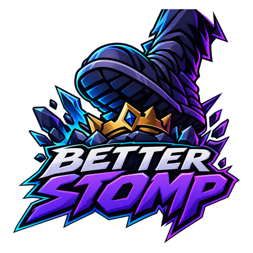

# BetterStomp

**Companion app gratuita per League of Legends** (Windows): statistiche dei campioni per rango e modalità, build consigliate, assistente in champion select con import automatico, analisi delle partite, note della patch e overlay in-game e per lo streaming.

<p align="center"></p>

## Funzioni

- **Profilo**: rango Solo/Duo e Flex, ruolo principale (calcolato su almeno 20 partite), maestrie, campioni più giocati, compagni premade ricorrenti e cronologia partite con analisi automatica ("Analizza"). Ricerca di altri giocatori per Riot ID.
- **Campioni e tier list**: win rate, pick rate, ban rate e tier da Ferro a Challenger, per Classificata Solo/Duo, Flex, Normali, ARAM, ARAM Mayhem, Arena e URF.
- **Build**: fino a 4 varianti di build per campione, ognuna con il suo win rate. Rune, incantesimi, ordine abilità e oggetti in blocchi da **5 - 10 - 10** slot, più matchup e sinergie. Editor per le build personali.
- **Sempre aggiornata**: i dati si aggiornano da soli (ogni 5 minuti più gli eventi in tempo reale) senza ricaricare la pagina.
- **Champion select**: suggerimenti *per matchup* o *per team comp*, correzione manuale dei campioni rilevati e import automatico di rune, incantesimi (Flash su D o F) e set di oggetti.
- **Patch**: note ufficiali riorganizzate in schede (buff, nerf e modifiche) con aggiornamento automatico all'uscita della patch, più le differenze rilevate dai dati di gioco.
- **Overlay in-game** (in stile Blitz): riquadro *benchmark* con CSM, GPM, KP, KDA e livello confrontati con la media dell'elo scelto al minuto di gioco attuale, più un obiettivo CS fisso opzionale; timer di obiettivi, giungla (anche sulla minimappa, insieme agli inibitori), buff Barone/Antico, respawn, vite in ARAM, valore oggetti e statistiche squadre. Tenendo premuto **TAB** in partita ogni riquadro si trascina, si blocca con il lucchetto, apre le impostazioni o si chiude, e si calibra la minimappa. I CS esatti vengono letti dallo schermo, perché l'API li aggiorna solo ogni 10. Notifiche obiettivi con promemoria personalizzabili.
- **Streaming**: overlay per OBS (fonte Browser 1920×1080) con rango, LP, partite di oggi e obiettivo stagionale con divisione.
- Tema scuro e chiaro; le impostazioni si applicano al volo.

## Come funziona

- **Client locale (LCU) e Live Client Data API**: profilo, champion select, import e overlay lavorano sul PC dell'utente, senza server esterni.
- **Riot API ufficiale** (chiave dell'utente): ricerca giocatori e un motore che analizza partite pubbliche classificate e ne aggrega le statistiche per patch, modalità, rango e ruolo. Sul PC vengono salvati solo conteggi aggregati.
- **Data Dragon** per campioni, oggetti e rune (in italiano).

## Avvio

Scarica `BetterStomp.exe` e avvialo: non richiede installazione. I dati vengono salvati nella cartella `BetterStomp-data`, accanto all'eseguibile. L'interfaccia si apre in una finestra dedicata (Microsoft Edge in modalità app).

Per l'overlay in-game imposta League in modalità **Senza bordi**.

## Compilare

Serve Go 1.24 o successivo:

```
GOOS=windows GOARCH=amd64 go build -trimpath -ldflags "-H windowsgui -s -w" -o BetterStomp.exe .
```

---

BetterStomp isn't endorsed by Riot Games and doesn't reflect the views or opinions of Riot Games or anyone officially involved in producing or managing Riot Games properties. Riot Games, and all associated properties are trademarks or registered trademarks of Riot Games, Inc.
